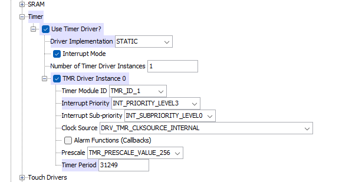
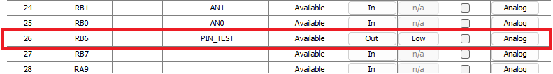
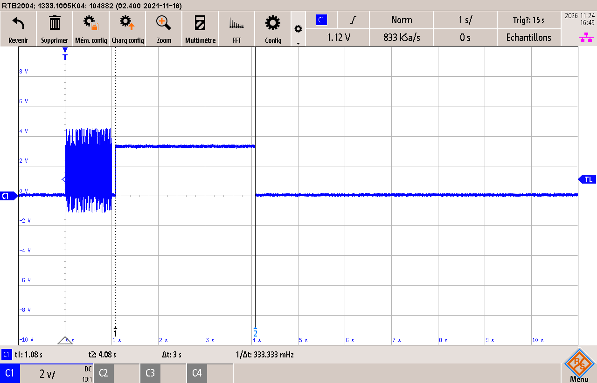

# MINF_TP0_26-27
Ceci est le repo git pour le TP0 de MINF pour l'année 2026-2027.

# Configuration du Timer 1
Dans le "Harmony Configurator", dans "Harmony Framework Configuration", dans "Drivers", dans "Timers", le timer est configurer de la façon suivante :
- La case "Use Timer Driver?" est cochée.
- "Driver Implementation" est mit en "STATIC".
- La case "Interrupt Mode" est cochée.
- "Timer Module ID" est mit en "TMR_ID_1".
- "Interrupt Priority" est mit en "INT_PRIORITY_LEVEL3".
- "Prescale" est mit en "TMR_PRESCALE_VALUE_256".
- La valeur 31'249 est inscrite dans "Timer Period".
Les deux prochains points explique le calcule de la valeur du prescaler et le calcule de la valeur du "Timer Period"

## Calcule du prescaler
Le datasheet du PIC32MX795F512L nous indique, au point 13.0 à la page 197 que le timer 1 est un timer 16bit.
Le nombre de "step" maximum qu'il peut compter est de 65'536 (2^16).
La consigne impose que le timer 1 doit faire son interruption toutes les 100ms et notre corps timer est de 80MHz.
Le prescaler se calcule de la façon suivante :
   1) Nbr de step sans prescaler = tVoulu (en microseconde) * fCoreTimer = (100'000 * 10^-6) * (80 * 10^6) = 100'000 * 80 = 8 * 10^6
   2) Prescaler = nbr de step sans prescaler / nbr de step maximum = 8 * 10^6 / 65536 = 122.07
Le prescaler requis est de 122.07 mais il n'existe pas et le timer 1 ne peut utiliser que les prescaler 1, 8, 64 et 256 (dans le datasheet du PIC32 au point 13-1 à la page 199).
Le prescaler sélectionné est donc le prescaler ayant une valeur supérieur à celui calculer, soit 256.

## Calcule du Timer Period
Le "Timer Period" se calcule de la façon suivante :
  1) fApresPerscale = fCoreTimer / prescaler = 80 * 10^6 / 256 = 312.5kHz.
  2) tApresPerscale = 1 / fApresPerscale = 1 / 312.5 * 10^3 = 3.2us.
  3) Timer Period = (tVoulu / tApresPerscale) - 1 = (100 * 10^-3 / 3.2 * 10^-6) - 1 = 31'249.
Dans le dernier calcul, le "- 1" vient du fait que le timer compte de 0 à 65'535, soit 65'536 valeur au total (sur la plage de comptage maximale).

La configuration doit ressembler à cela :

# Oscillogrammes du chenillard
Les explications du comportement des LEDs sur un cycle de chenillard considèrent qu'un cycle de chenillard début à l'allumage de la LED D6 et fini lorsque celle-ci s'allume à nouveau.

## Oscillogramme LED D6 (1ère LED)

.png)

Le temps bas sur le channel 1 est le temps durant lequel la LED D6 est allumée.
La mesure effectuée à l'aide des curseurs montre qu'elle reste allumée pendant 200ms. Cela prouve que l'appel de la fonction chenillard est bien effectuer toutes les 200ms.
Voici comment la LED D6 se comporte lors d'un cycle complète du chenillard 
   1) La LED D6 s'allume pendant 200ms.
   2) La LED D6 s'éteint pendant 2.6s.
   3) Le cycle recommence.

## Oscillogramme LED D10 (2ère LED)

.png)

Les temps bas sur le channel 2 sont les temps durant lesquel la LED D10 est allumée.
La mesure du temps bas par les curseurs montre, elle aussi, que la LED D10 reste allumée durant 200ms.
L'oscillogramme montre la séquence suivante : Temps bas, temps haut de la même durée que le temps bas précédent, temps bas et temps haut pendant une durée plus longue avant d'arriver sur un temps bas qui indique le début d'une nouvelle séquence.
Cela vient du fait que mon chenillard fait un aller-retour. 
Voici comment la LED D10 se comporte lors d'un cycle complète du chenillard 
   1) La LED D10 est éteinte pendant 200ms.
   2) La LED D6 s'éteint et la LED D10 s'allume pendant 200ms.
   3) La LED D10 s'éteint pendant 2.2s, le temps que le chenillard aille de la LED D7 (3ème LED) à la LED D13 (8ème LED) et revienne jusqu'à la LED D6.
   4) La LED D10 s'allume à nouveau pendant 200ms.
   5) Le cycle recommence.

## Oscillogramme LED D7 (3ère LED)

.png)

Les temps bas sur le channel 3 sont les temps durant lesquel la LED D7 est allumée.
La mesure du temps bas par les curseurs montre, elle aussi, que la LED D7 reste allumée durant 200ms.
Voici comment la LED D7 se comporte lors d'un cycle complète du chenillard 
   1) La LED D7 est éteinte pendant 400ms.
   2) La LED D7 s'allume pendant 200ms.
   3) La LED D7 s'éteint pendant 1.8s.
   4) La LED D7 s'allume à nouveau pendant 200ms.
   5) La LED D7 est éteinte pendant 200ms.
   6) Le cycle recommence.

## Oscillogramme LED D11 (4ère LED)

.png)

Les temps bas sur le channel 4 sont les temps durant lesquel la LED D7 est allumée.
La mesure du temps bas par les curseurs montre, elle aussi, que la LED D11 reste allumée durant 200ms.
Voici comment la LED D7 se comporte lors d'un cycle complète du chenillard 
   1) La LED D11 est éteinte pendant 600ms.
   2) La LED D11 s'allume pendant 200ms.
   3) La LED D11 s'éteint pendant 1.4s.
   4) La LED D11 s'allume à nouveau pendant 200ms.
   5) La LED D11 est éteinte pendant 600ms.
   6) Le cycle recommence.

# Mesure des 3s avant l'activation de l'état APP_STATE_SERVICE_TASKS et configuration de la pin requise
## Configuration de la pin de mesure
Une pin spécifique du PIC32 à été configurer afin de pouvoir mesurer le temps entre le démarrage du timer 1 et le passage dans APP_STATE_SERVICE_TASKS.
Pour ce faire, il faut : 
   1) Aller dans le "Harmony Configurator", dans "Pin Settings" et choisir une pin inutilisée.
   2) Dans la colonne "Name", nommé la pin. Dans ce cas, elle s'appelle PIN_TEST.
   3) Dans la colonne "Direction (TRIS)", la mettre en "Out". Cela fera qu'elle est configurée pour avoir un signal en sortie si on le souhaite.
   4) Dans la colonne "Latch (LAT)", la mettre en Low.
   5) Appuyer sur les rouages pour générer le code.
   6) Dans le app.h, définir le write, le tristate, le port et la position du bit de la pin de la manière suivante :
   - #define PIN_TEST_W       LATBbits.LATB6
   - #define PIN_TEST_T       TRISBbits.TRISB6
   - #define PIN_TEST_PORT    PORT_CHANNEL_B
   - #define PIN_TEST_BIT     PORTS_BIT_POS_6
      
La pin choisie étant la pin RB6, son port est le B et sa position est la 6, si la pin choisi avait été, par exemple RA11, les #define auraient été faite de la façon suivante :
   - #define PIN_TEST_W       LATAbits.LATA11
   - #define PIN_TEST_T       TRISAbits.TRISA11
   - #define PIN_TEST_PORT    PORT_CHANNEL_A
   - #define PIN_TEST_BIT     PORTS_BIT_POS_11

Voici l'image illustrant les points 2) à 4) :

## Mesure des 3s

La mesure montre qu'à l'initialisation du système, il y a du bruit sur la pin puis que le bruit s'estompe très peu de temps avant que la pin PIN_TEST soit mise à l'état haut (juste après le démarrage du timer 1 dans le code).
La mesure par les curseurs montre qu'elle reste à l'état haut pendant 3s avant de revenir à l'état bas, ce qui correspond à l'entrée dans l'état APP_STATE_SERVICE_TASKS (la mise à l'état bas de la pin PIN_TEST est la première chose qui est faite dans l'APP_STATE_SERVICE_TASKS).
Pour faire cela, les fonctions PLIB_PORTS_PinSet() et PLIB_PORTS_PinClear() ont été utilisées pou, dans l'ordre, mettre la pin PIN_TEST à l'état haut puis à l'état bas.

# Listing du code
Les fichiers app.c, app.h et system_interrupt.c se trouvent, en annexes, dans ce dépôt git.

# Commentaires complémentaires
Vous pouvez voir que les images sont en double dans le repo.
Cela vient du fait qu'initialement j'avais ajouté les images contenant des espaces dans leurs noms via le bouton "Add file" et "Upload files" mais les espaces font que ces png ne peuvent pas être utiliser avec la commande "".
J'ai donc renommé mes png puis les ai remis dans le repo via le bouton "Add file" et "Upload files" et je n'ai pas réussi a supprimer les anciennes images.
Quand je cliquais dessus et que cela m'ouvrait le "dossier" de l'image, je pouvais cliquer sur les trois petits points puis cliquer sur "Delete file". Git m'indiquait alors que le file était supprimer mais quand je rechargeais la page, l'image était toujours la.

Aussi j'ai suivit les indications du git "PROG_SLO_26_27" pour avoir mon dépôt git en local mais cela n'as pas fonctionner. C'est pour cela que je suis passé par les "Add file" et "Upload files" pour mettre mes mesures sur le git afin d'éviter de perdre trop de temps sur ce problème.
